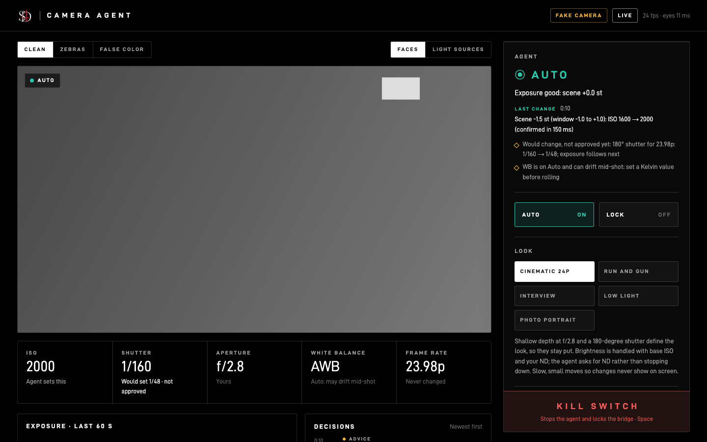

# Camera Agent

**An AI camera assistant that runs exposure like a cinematographer.** It watches the live image from a Sony FX2, judges it the way a DP would (in stops, protecting highlights, holding faces), sets the ISO itself, and explains every choice in one plain line. For example: *"Face −1.9 st (target +0.5): ISO 2000 → 4000 (base ISO)"*. You pick the look; it handles the rest, and you can take control back at any moment with one key.

An S4D project, directed by Saad Hilal. Code written with an AI coding assistant (see [How this was built](#how-this-was-built)).



**Status (2026-10-21):**
- Steps 1–6 and 8 are built, and the live closed-loop ISO test on the real FX2 passed (2026-10-19).
- The real-world comparison (Step 7) is planned and frozen, and is shot on Saturday 2026-10-24.
- Every result below is labeled with where it came from: **real camera**, **recorded frames**, **simulator** or **fake camera**.
- Day-by-day log: [PROGRESS.md](PROGRESS.md).

## What it does

1. **Sees.** It reads the FX2's live view over USB at 24 fps and measures it in stops vs 18% grey, using the S-Log3 curve calibrated on this camera. It measures exposure in 48 regions, clipping (ignoring small practicals like lamps), faces (OpenCV's YuNet detector) and the color of the light.
2. **Decides.** Explainable rules, no black box:
   - hold a 180° shutter
   - the aperture comes from the look
   - protect important highlights first, then faces, then the scene
   - ISO fills the gap, preferring the FX2's base ISOs 800 and 4000
   - ND and lighting needs become **advice** ("add at least 3 stops of ND"), since the agent can't turn a physical ND
3. **Acts, carefully.** Every change goes through one safety function. It changes **only what you've approved** (today: ISO 800–12800), never while the camera is recording, and every change is logged with time, old value, new value and reason.
4. **Shows you.** A web dashboard in S4D style:
   - live view with zebras and false color
   - each setting, and who owns it
   - the last decision and why, plus the full decision history
   - the five looks
   - Auto, Lock, and "this face looks right"
   - the big kill switch

**Five looks:** Cinematic 24p (shallow), Run and gun, Interview (face priority), Low light, Photo portrait. Each sets the f-stop, how fast it reacts, how much clipping it accepts and where faces sit. Details: [docs/step5-brain.md](docs/step5-brain.md).

## How it thinks (the cinematography rules)

| Rule | Why a DP does it |
|---|---|
| 180° shutter (1/48 at 23.98p) | Natural motion blur; shutter isn't an exposure tool in a cinematic look |
| Aperture from the look | Depth of field is a creative choice, not a light meter |
| Highlights → faces → scene | Clipped detail is gone for good; faces are what the audience watches |
| Base ISO 800 / 4000 first | Cleanest image on the FX2 in S-Log3 (read from the camera's own menus) |
| ⅓-stop dead band, wait before reacting, small steps | A walk-by or a flicker shouldn't make the picture pump |
| Remember what clipped | After pulling down for clipping, don't go back up unless the light really dropped |
| Lock while recording | Nothing changes mid-take unless you allow it |

## Safety (this is a real work camera)

| Layer | What it does |
|---|---|
| Dry run by default | Nothing is sent unless you start it with `--live` **and** type `LIVE`. With the dashboard, Auto also starts Off and takes two presses. |
| Your approved list | Only settings marked approved in `config/safe_ranges.json` can change (today: ISO 800–12800). Everything else is advice. |
| Safety gate (Python) | Checks ranges, refuses while recording or after the kill switch, logs every change with its reason. |
| Bridge (C++) | Its own allow-list compiled in, plus read-only mode, a lock, and recording checks. It's the only code that can call Sony's "set" function, and the read-only tools can't even compile one. |
| **Kill switch** | **Space**, the dashboard button, Ctrl-C, `tools/kill_switch.py` from any terminal, or the USB cable. It locks the bridge until restart. |
| Runaway guard | More than 20 changes in a minute trips the kill switch. |
| Snapshot and restore | Settings saved at the start and end of every session; it offers to put ISO back. |

Never touched, ever: card format, file delete, firmware, record format, codec, frame rate, resolution, picture profile, media settings, record start/stop.

## Exposing every skin tone correctly

The agent is designed to expose correctly across skin tones.

- **It never guesses or labels anyone's skin tone.** It measures how bright each face is, in stops relative to 18% grey, and compares that with a target.
- **The default face target is +0.5 stop.** The common "skin at +1 stop" rule of thumb comes from lighter skin and pushes darker skin too bright, so the default sits lower (director's decision, 2026-10-17).
- **Set each person once: "this face looks right."** Frame the person and press it. The agent remembers that person (a face signature from OpenCV's SFace model) and holds their face at the exposure *you* approved. The cinematographer's eye decides, not a formula. Saved only for people who agree, only on this computer (never uploaded, never in this repo), and "Forget" deletes them.
- **Faces never clip:** a clipping face is treated like a clipping window, for everyone.
- **Honest status:** not yet tested on a range of skin tones with the real camera. That is part of the Step 7 test plan.

## Results so far

| What | Result | Source |
|---|---|---|
| Live view | 24 fps (matches 23.98p), 0 frames missed | real camera |
| Eyes speed | ~10 ms per frame on an M2 | real camera |
| A setting change | confirmed in 119–172 ms; shows in the picture 272–325 ms later | real camera (ISO 800 → 1000 → 800) |
| Calibration | 20.63 levels per stop, clip at 221; an ISO third-stop measures +0.331 stops (true value +0.333) | real camera, white wall |
| Not fooled by a hand and a chat window in frame | exposure change read as 0.00 stops (correct) | recorded frames |
| Smoothness | 14 simulated situations (sunset, walk-bys, shade → sun, tungsten…): 0 back-and-forth | simulator |
| A pumping bug | found on your real frame through the fake camera (6400 ↔ 5000), fixed, and kept as a test | fake camera |
| Face recognition | same face matched across 2.3 stops of exposure change: 0.97 similarity (threshold 0.36) | recorded frame |
| Automated tests | 1 passing | — |
| **Agent vs FX2 auto vs manual, blind test** | **not done yet**: plan written and frozen before shooting ([docs/step7-test-plan.md](docs/step7-test-plan.md)) | — |

Demo video: coming after Step 7.

## Set it up (macOS, Apple Silicon)

You need: an FX2 (USB mode **Remote Shoot/Trn.**), CMake (`brew install cmake`), Apple's Command Line Tools, and [uv](https://docs.astral.sh/uv/) for Python.

### 1. Get Sony's Camera Remote SDK

This project talks to the camera through Sony's Camera Remote SDK. Sony's license does not allow the SDK files (libraries, headers, sample code, docs) to be shared, so they are **not** in this repo. Each developer downloads them from Sony:

1. Go to Sony's Camera Remote SDK page: https://www.sony.net/CameraRemoteSDK/
2. Read and accept Sony's license agreement, then download the package for your OS (this project was built with **CrSDK v2.02.00 for macOS**).
3. Put the zip in the project folder and unzip it into `sdk/`:

   ```
   unzip CrSDK_v2.02.00_*_Mac.zip -d sdk/
   cd sdk && unzip RemoteCli.zip -d RemoteCli && unzip CrSDK_API_Reference_v2.02.00.zip -d CrSDK_API_Reference_v2.02.00
   ```

`sdk/` and the zip are listed in `.gitignore` so they are never committed.

On macOS, remove the download "quarantine" flag from Sony's libraries (Sony's instruction):

```
cd sdk/RemoteCli/external/crsdk
xattr -d com.apple.quarantine libCr_Core.dylib libmonitor_protocol*.dylib CrAdapter/*.dylib
```

### 2. Build the bridge, set up Python, fetch the face models

```
cmake -S bridge -B build/bridge && cmake --build build/bridge -j2
uv venv --python 3.11 .venv && uv pip install --python .venv/bin/python -r requirements.txt
sh tools/fetch_models.sh          # YuNet (MIT) and SFace (Apache 2.0), checked by SHA-256
.venv/bin/python -m pytest -q     # 62 tests, no camera needed
```

### 3. Run it

```
# No camera at all: a fake FX2 that speaks the bridge's protocol
.venv/bin/python tools/run_agent.py --fake --dashboard          # then open http://127.0.0.1:8770/

# Real camera, read-only first (the bridge refuses every change)
(cd build/bridge && ./camera_bridge ~/camera-agent/run/bridge.sock ~/camera-agent/sessions/my-session --read-only)
.venv/bin/python tools/run_agent.py --dashboard                 # dry run: suggestions only

# Live (bridge started without --read-only): type LIVE, then press Auto twice on the page
.venv/bin/python tools/run_agent.py --live --dashboard
```

Keys: **Space** kill switch · `p` Auto on/off · `l` Lock · `m` mark an event · `1`–`5` look · `q` quit (offers to restore ISO).

## Project layout

| Folder | What's there |
|---|---|
| `bridge/` | C++ bridge to Sony's SDK (the only code that can change the camera), and a read-only probe |
| `agent/` | `eyes.py` (measuring), `brain.py` (deciding), `safety.py` (the one change function), `runner.py` (the loop), `dashboard.py`, `faces.py` |
| `dashboard/` | The web page (S4D style) |
| `tools/` | Run the agent, fake camera, kill switch, calibration, simulator, screenshots, Step 7 scoring |
| `config/` | Approved ranges, live-view calibration |
| `docs/` | One write-up per step, screenshots, results |

## Honest limits

- **Live so far: one static scene.** On 2026-10-19 the agent ran live on the FX2, pointed at a white wall lit by a lamp. That was the ISO test, a self-test of aperture, shutter and WB, and a short automatic run with all four ([docs/step5-live-test.md](docs/step5-live-test.md)). Lighting changes, people and faces haven't been tested live yet; that's Step 7.
- **ISO** is the only setting that changes by default. Aperture (f/2.8–f/11), shutter (1/48–1/100) and WB (Auto or 2800–7500K) are approved too, but only behind a startup switch, `--allow-exposure`, that's off by default. The Step 7 test uses ISO only.
- The WB reading is only trusted within about 100 mired of the light. If the WB is set further off than that, the agent leaves WB alone rather than guess.
- No focus actions (by design, for now).
- The live view is S-Log3 as the FX2 sends it; there's no viewing LUT on the dashboard yet.
- The calibration is measured from level ~82 up. The very deep shadows are extrapolated, and in a very dark room the camera's own meter and our reading differed by ~1.7 stops (likely reasons in [docs/step4-eyes.md](docs/step4-eyes.md)).
- The eyes' rule for "small practical vs big bright area" can flip around a lamp. The brain copes (clipping memory), but the rule itself is crude.
- The dashboard has no password, so it's for this computer only until one is added (needed for the Pi + phone plan).
- macOS 27 and the Raspberry Pi 5 aren't on Sony's tested list. The Mac works; the Pi is a plan ([docs/step8-pi-plan.md](docs/step8-pi-plan.md)).

## How this was built

**I directed the project and designed the cinematography rules, and an AI coding assistant wrote the code.** I set the goal, the looks, the safety rules and approved ranges for my own camera, and every decision (for example: ISO only for the first live test; warn and pause when a setting starts outside my ranges; face target +0.5 with a per-person reference). I set up and approved every camera test, ran the early ones and the calibration myself, and gave the go for the first live agent run, which ran unattended. I reviewed each step before the next began. The AI read Sony's SDK, wrote the C++ bridge, the Python agent, the tests and the dashboard, and reported what didn't work as clearly as what did. Each step ended with a check-in and a commit; the record is in [PROGRESS.md](PROGRESS.md) and `docs/`.

## Credits

- Sony Camera Remote SDK (not included; see above)
- OpenCV, with the YuNet face detector (MIT) and SFace face recognizer (Apache 2.0) from the OpenCV model zoo
- Typeface: D-DIN by Datto, SIL Open Font License

## Built by

Built by Saad Hilal · S4D.
