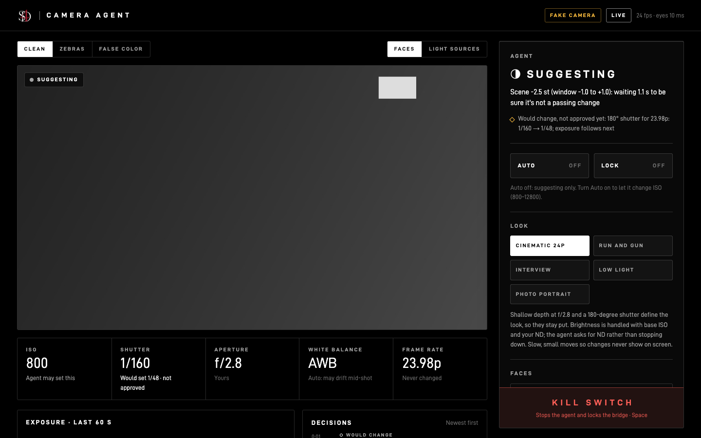
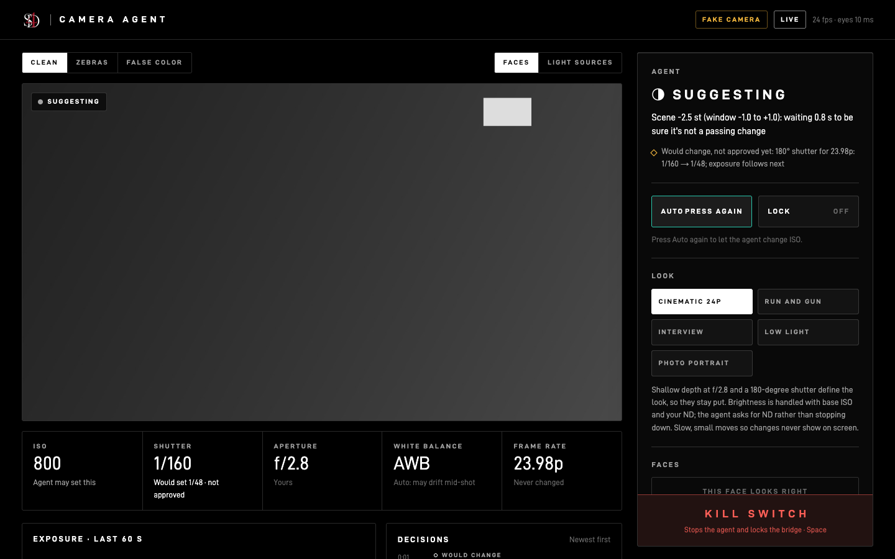
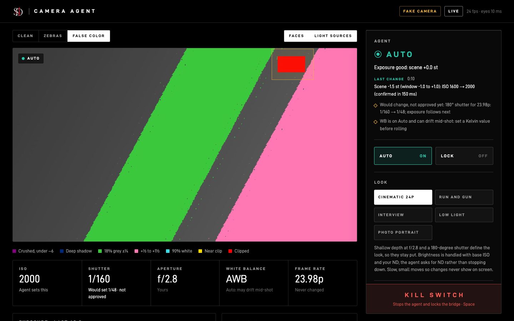
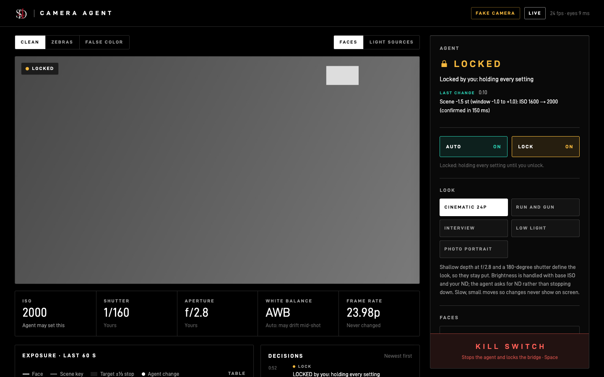
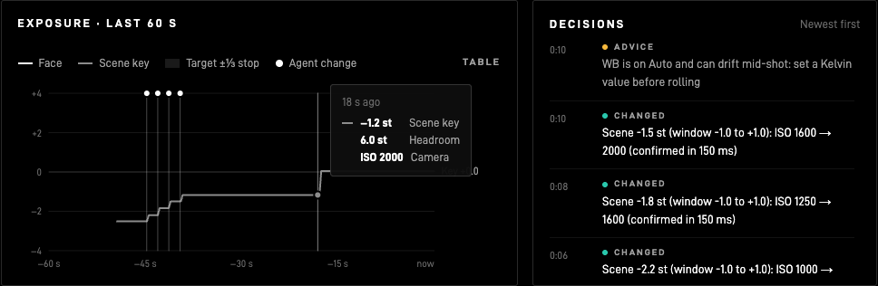
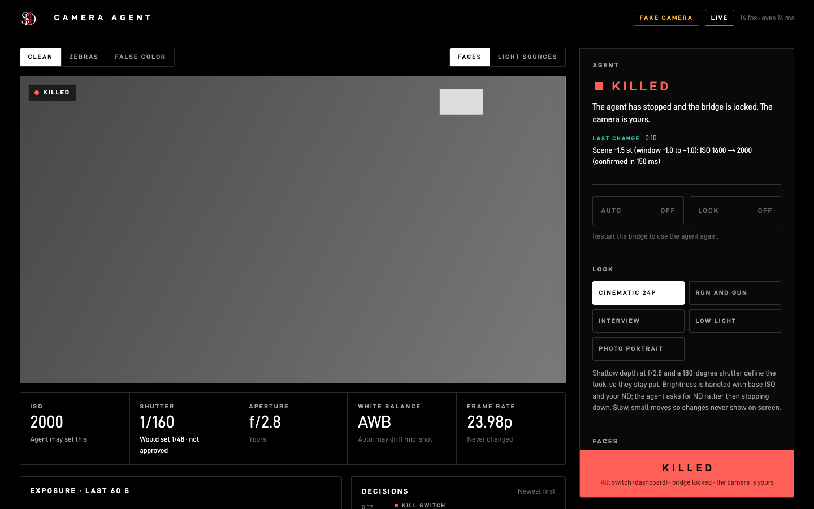
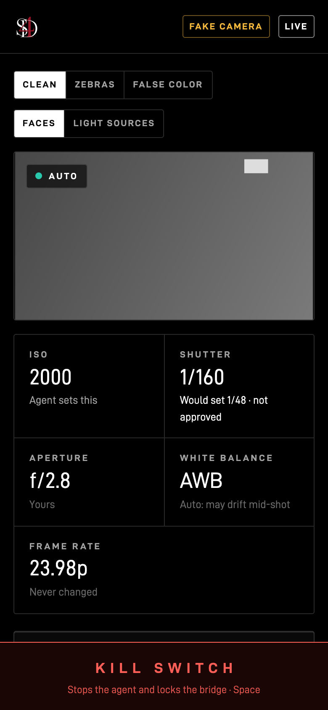
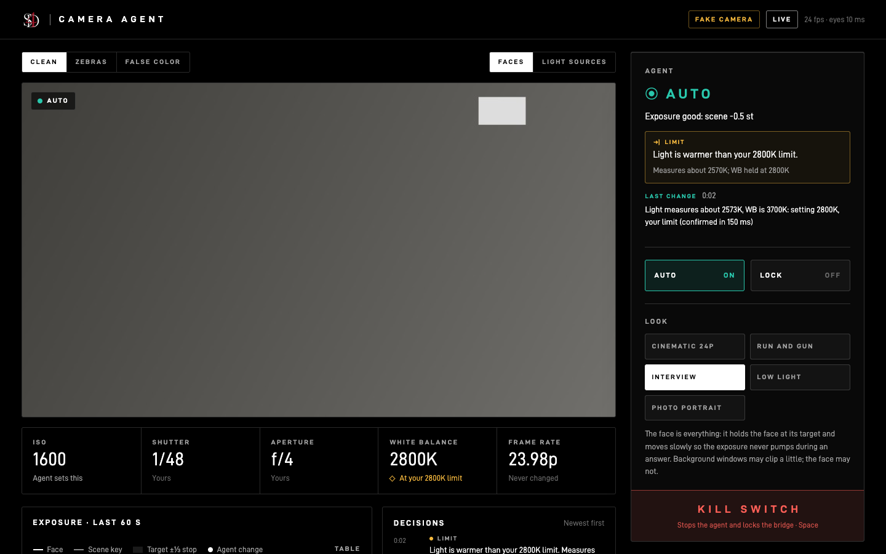

# Step 6: The dashboard

A web page that shows what the agent sees, what it decided and why, and gives you the controls: look, Auto, Lock, "this face looks right", and the big kill switch. Built and checked on the **fake camera only** (no Sony cinema camera connected).

```
python tools/run_agent.py --fake --dashboard              # fake camera, then open http://127.0.0.1:8770/
python tools/run_agent.py --dashboard                     # dry run on the real camera (bridge must be running)
python tools/run_agent.py --live --dashboard              # live: type LIVE, then press Auto on the page (twice)
```


## What's on it

| Part | What it shows / does |
|---|---|
| **Live view** | The camera's live view (S-Log3, as the camera sends it), ~12 fps in the browser while the agent itself runs at 24. **Clean / Zebras / False color**, plus face brackets and light-source cells you can switch on and off. |
| **State badge** | One word, always with an icon: **Auto** (changing ISO), **Suggesting** (watching, nothing sent), **Locked** (you're holding everything), **Recording** (rolling: nothing changes), **Killed**. |
| **Setting tiles** | ISO, shutter, aperture, WB, frame rate. Each says who owns it: "Agent sets this" (ISO), or "Would set 1/48 · not approved" when the brain wants a change you haven't approved. |
| **Status + last change** | The brain's current one-line reason, the last change with its time and reason, and any advice (ND, light, WB). |
| **Limit** | When one of your limits stops a fix, an amber box under the status says which and why, e.g. **"Light is warmer than your 2800K limit."**, with the measurement underneath. The setting's tile says "At your 2800K limit", and the Decisions feed logs it once. See "Limits" below. |
| **Auto** | On: the agent changes ISO. Off: it only suggests. In a live session it **starts Off**, and turning it on takes **two presses** (the first arms it for 3 s). Off is one press. |
| **Lock** | Holds every setting as it is now, the same lock that happens automatically while recording, until you unlock. Unlike Auto off, the brain goes quiet too. |
| **Look picker** | The five looks, with the one-paragraph description of the chosen one. Keys 1–5. |
| **This face looks right** | Frame a person and press it (optional name). From then on the agent holds that person's face at that exposure, instead of the look's +0.5. Saved people are listed with **Forget**. See "Faces" below. |
| **Highlights** | Headroom to clip (stops) and important-area clipping vs the look's limit. |
| **Exposure chart** | Last 60 s: face (white), scene key (grey), the target with its ⅓-stop dead band, and a dot for each agent change. Hover for the values and the change's reason. A **Table** view has the same numbers. |
| **Decisions** | Every change, would-change, advice, lock, look and face event, newest first, each with its reason. |
| **Kill switch** | Always on screen: bottom of the side panel on a computer, pinned to the bottom of the screen on a phone. **Space** works too. It stops the agent and locks the bridge; the page then says **KILLED** and stays up so you can see it. |

Keyboard on the page: **Space** kill switch · **a** Auto · **l** Lock · **m** mark a scene event (Step 7) · **1–5** look. The terminal keys still work at the same time (SPACE, p, l, m, 1–5, q).

## Faces: "this face looks right"

- It stores two things per person: a **face signature** (128 numbers from OpenCV's SFace model, Apache 2.0, so it can recognize the person next time) and **the exposure you approved**, in stops.
- No skin-tone classification anywhere. Your eye sets the target, person by person.
- **Only for people who agree.** Ask first; if someone says no, don't press it for them (the agent then uses the look's default for that face).
- Signatures are biometric data, so they stay **only on this computer** (`config/face_refs.json`, never committed, never uploaded), the page never receives them, and **Forget** deletes them (director's decision, 2026-10-18).
- Checked on your real Step 4 frame through the fake camera: your face matched itself across 2.3 stops of exposure change at 0.97 similarity (OpenCV's threshold is 0.36), in 5–8 ms. Set at −2.3 st, then the light dropped 1 stop, and the agent brought you back: *"Face −3.2 st (Saad's target −2.3): ISO 1600 → 2000"*, then 4000 (base). Those screenshots show your face, so they're only in `sessions/2026-10-17_dashboard-screens-with-face/` (not committed).

## Design

S4D, matched to the LANDFALL site: pure black, D-DIN and D-DIN Expanded (SIL Open Font License), letter-spaced caps, hairline borders, one glass console, the S4D mark, "Built by Saad Hilal · S4D" in the footer. Colour only means status, and always comes with a word and an icon: teal = agent working, amber = held / advice, red = killed, recording or clipping. The dataviz checks were applied to the chart (thin 2 px lines, recessive grid, a legend plus end labels, crosshair tooltip, table view), and the status colours pass the colour-blind and contrast checks on black.

## Checked with screenshots

Taken by a script that uses the page like a person (`tools/dashboard_screens.py`: clicks Auto twice, hovers the chart, switches modes, locks, opens it on a phone-size screen, presses the kill switch). No browser errors.

| | |
|---|---|
|  |  |
| Dry start: suggesting only | Auto armed: press again |
|  |  |
| False color + light sources | Locked by you |
|  |  |
| Chart tooltip and decisions | Killed: the page stays up and says so |

Phone: 

**Bugs the screenshots caught (fixed):**
- The decision list overlapped itself: the chart legend's dot style also matched the decision rows. Now scoped to the legend.
- The chart tooltip vanished because the chart redraws 4 times a second. It now remembers the pointer.
- "Now" sat at the right edge even when the data ended 35 s earlier.
- After a kill, Auto still showed "On".
- On a phone, your controls came after the chart. Now it's picture → settings → agent → chart → decisions.

## Limits (added 2026-10-19)

Your request after the live test: when the agent hits a limit, show the reason. On the real camera the lamp measured about 2620K, so WB stopped at your 2800K floor without saying why. Now:

| What stops it | What the dashboard says | Underneath |
|---|---|---|
| Light warmer / cooler than your WB range | Light is warmer than your 2800K limit. / Light is cooler than your 7500K limit. | Measures about 2610K; WB held at 2800K |
| Too dark with ISO (and aperture) at the top | Scene is too dark for your ISO 12800 limit. / …for your ISO 12800 and f/2.8 limits. | Needs about 2 stops more light |
| Too bright with ISO at the bottom | Scene is too bright for your ISO 800 limit. | Needs about 2 stops less light; f/2.8 is as far as the Cinematic 24p look goes |
| 180° needs a shutter outside your range | 180° needs 1/120, faster than your 1/100 limit. | Shutter held at 1/100 (216°) |

- **Only your limits count:** a setting you haven't approved shows as "Would change, not approved yet", not as a limit.
- **WB:** within about 20 mired of the limit is close enough, so no message. The message stays through a moment of untrusted color (someone walks through) and clears when the light measures inside your range.
- **The change itself names it too:** "Light measures about 2642K, WB is 3700K: setting 2800K, your limit".



## Safety and security

- The page can only do what the keyboard can: Auto, Lock, look, faces, kill. It **cannot start a live session**: that still needs `--live` and typing LIVE in the terminal.
- It listens on **this computer only** (127.0.0.1). Buttons need a special header that other websites can't send, and the Host is checked, so a random web page can't press them (tested).
- Phone access (the Pi plan) means opening it to the network (`--host 0.0.0.0`), and there's **no password yet**. Add one before using it on a shared network.

## Tests

58 passing in total. New: 5 dashboard tests (state and frames; buttons refused without the header or with the wrong host; Auto starts off and changes nothing until turned on; Auto can't turn on in a dry run; Lock holds and the kill switch locks the bridge) and 3 face tests (recognized and holds their target; setting again updates, not duplicates; forget, and signatures never leave the computer).

## Honest limits

- Only tried on the fake camera. On the real camera, frame timing and the browser's load are untested.
- The live view is the flat S-Log3 picture (that's what the camera sends); there's no viewing LUT yet.
- Face recognition is OpenCV's model at OpenCV's threshold. It hasn't been tested on more than one person, or on a range of skin tones (Step 7).
- No password for network use (above).
