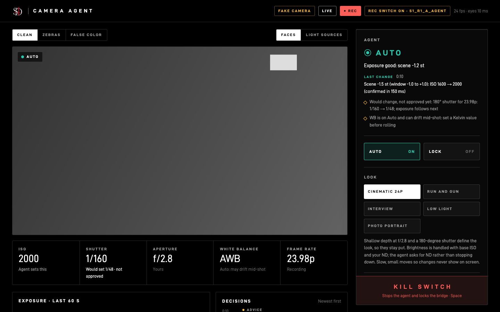
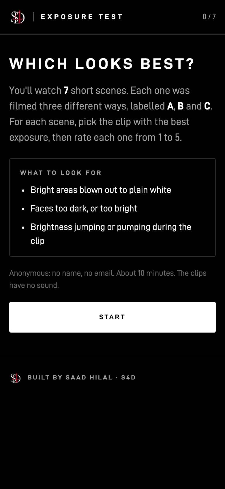
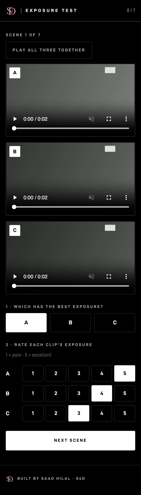
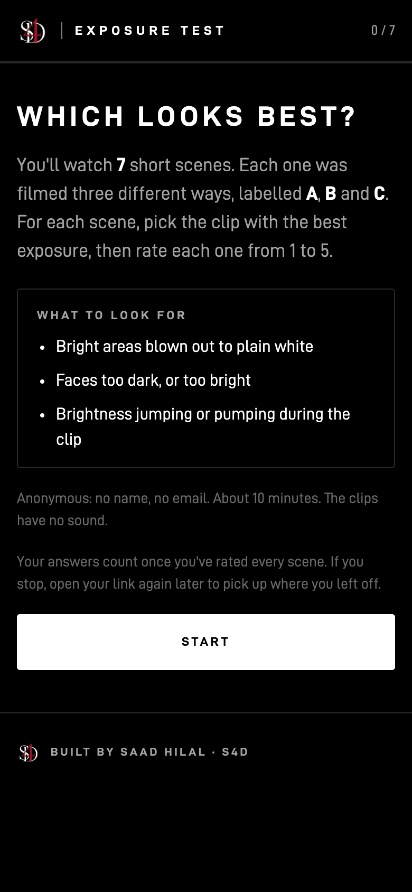

# Step 7 tools (built after the plan was approved)

The plan itself is frozen ([step7-test-plan.md](step7-test-plan.md), tag `step7-plan-final`). These are the tools it needs on the day and afterwards. None of them needed the camera to build; all were tried on the fake camera or with stand-in clips.

## 0. On the day: two Terminal windows

**The whole day, step by step, is on one page: [step7-day.md](step7-day.md).**

```
tools/step7.sh bridge            # window 1, once: the bridge with the Step 7 switch; keeps the Mac awake
tools/step7.sh S1_R1_A_agent     # window 2, each take: that take's exact run-sheet command
```

- **Window 1** removes an old socket, starts the bridge with `--allow-iso-while-recording` and waits until the camera answers. Leave it open all day; Ctrl-C at the end stops the bridge.
- **Window 2** looks the take up on the run sheet and runs its command: the look, live or dry run, and the switch, with the dashboard on port 8770 (8765 is robot-walker's). A name that isn't on the sheet is refused with the closest matches. `--print` only shows the command.
- **The runner now also logs** when the camera starts and stops recording (a `rec` event), so the blind-test clips can be cut from the mark.
- **Safe to retype:** a take whose bridge isn't answering, or whose dashboard port is taken, stops before it makes a folder. FX2-auto and manual takes never offer to put ISO back.
- **Watching from a third window:** `python tools/watch_session.py` follows the newest session.
- **Scoring afterwards:** `python tools/score_take.py sessions/*_S1_R1_*` (any list of take folders; `--json out.json` saves it). Folders with no data, or recorded on the fake camera, are skipped and listed. A take whose name and mode disagree (an `_agent` take that ran as a dry run) is flagged `CHECK`.

### Write on the printed run sheet (by hand; the sheet itself stays as printed)

- **Front:** Manual takes keep the **iris fixed** at the look's f-stop (Clarification 1).
- **At each person's first take** (S1_R1_A_agent, S1_R2_B_agent): press **"this face looks right"** and name them **A** or **B** in the face box (Clarification 2 finds their target by that name).
- **S5 rows:** each is a 2-minute block.
- **S6 rows:** don't press m.
- **Every take:** write the camera's clip number in the notes column. Before the first take, check the FX2's clock against the Mac's.

## 1. The recording switch (agent takes only, off by default)

The agent normally changes nothing while the camera records. For Step 7 agent takes only, you approved one exception: **ISO, and nothing else, may change while recording.** All three layers must agree, and each refuses on its own:

| Layer | How it's switched on | What it allows |
|---|---|---|
| C++ bridge | Started with `--allow-iso-while-recording` (startup only; can't be combined with `--read-only`; can't be turned on later) | ISO while recording; every other setting still refused |
| Safety gate | The runner's switch | ISO while recording; logs `while_recording` on every change |
| Runner | `--allow-iso-while-recording`, which only starts if it's live, has a take name like `S1_R3_A_agent`, and the bridge has its flag on | Lock still holds; kill switch still works |

The dashboard shows a red **REC** chip, plus an amber **"Rec switch on · S1_R3_A_agent"** chip while it's on.



**On the day:** start the bridge with the flag for a Step 7 session and restart it without the flag afterwards. The runner's switch goes on per agent take, as the run sheet says. FX2-auto and manual takes run in dry run, so nothing is ever sent in those.

9 tests: off by default; refuses to start unless everything lines up; ISO changes while recording with both switches on; Lock holds; the gate allows only ISO; the bridge refuses if its own flag is off even when the gate says yes.

## 2. The Display LUT reader (read-only)

`python tools/read_display_lut.py sessions/<folder>`, with the bridge started `--read-only` (it refuses otherwise). It reads from the camera:
- **Display LUT** on or off (`MonitorLUTSetting`)
- **the selected Base Look** (`BaseLookValue`, decoded as Sony documents it: preset, user, scene file or temporary, plus an index)
- **the camera's own names** for every Base Look (Sony's display strings)

It prints one line to copy into the plan, e.g. *"Base Look: … (User, value 0x0101), Display LUT: ON, read on …"*. Then you find that LUT's `.cube` file and its exact file name goes into the plan **before any clip is graded**.

**Read on 2026-10-19:** Display LUT **OFF**, Base Look **"S-Log3"** (Preset, value 0x0001), which applies no conversion. The camera's other Base Looks are s709, 709(800%) and User1–16, all empty ("No Import"). So there was no LUT file to name.

**Picked 2026-10-19: Sony's LC-709TypeA.** The director first chose s709. The same evening, before any grading, they switched to the Sony LUT already on their Mac. The plan's LUT line names the exact file.
- **The file:** `2_SGamut3CineSLog3_To_LC-709TypeA.cube`, from Sony's LookProfile LUTs for S-Log3/S-Gamut3.Cine.
  - Its header reads "Sony LookProfile LUT, SLog3SGamut3.CineToLC_709TypeA full in full out v1.04.04".
  - 33-point cube, SHA-256 `04066dc0…4c236d` (the full checksum is in the plan and in [luts/README.md](../luts/README.md)).
- **Why this one:** the Mac had four Sony looks for S-Gamut3.Cine/S-Log3 (LC-709, LC-709TypeA, SLog2-709 and Cine+709), and no plain Rec.709 one. LC-709TypeA is the usual choice and gives an ordinary-looking finished picture, so raters judge exposure, not a style.
- **Which gamut:** the FX2 records movies in **S-Gamut3.Cine** (`MovieShootingModeColorGamut` = 1, read 2026-10-19). The other gamut setting, `LogShootingModeColorGamut`, is for stills.
- **Full in, full out:** it expects full-range RGB and returns full-range RGB. That's what Resolve and ffmpeg's `lut3d` give a LUT, so no level changes are needed.
- **On the camera:** LC-709TypeA isn't one of the FX2's built-in Base Looks (s709, 709(800%)). The blind test doesn't need it there, since the clips get it afterwards.
- **Where it lives:** a copy in `luts/`; the original stays where it was. `luts/` stays out of the repo, like the SDK, because it's Sony's file. Only `luts/README.md` is published.

## 3. The printable run sheet

`python tools/make_run_sheet.py` makes [step7-run-sheet.pdf](step7-run-sheet.pdf) (and `.html`): Letter, landscape.
- **Front:** consent per person, the face-memory choice, and the session checklist (bridge flag on, then off again; kill switch reachable).
- **Then every take in shooting order (87 rows):** 63 scored takes, 6 bonus takes and 18 sunset blocks, each with the exact command and tick boxes (Auto on / camera Auto ISO on and back off / Rec started / m / Rec stopped / q).
- **People are A and B.** Names are written on the paper, never in the repo.
- **Which takes go to the blind test is deliberately not on the sheet,** so nobody shoots those differently.
- It comes from the frozen order, and a test fails if that order ever changes.

## 4. The private rating page (blind test)

**First, where to cut the 21 clips:** `tools/blind_clips.py` reads the session logs and prints, for each drawn take, the 12-second window's in and out points inside the camera clip. It follows the plan's rule: starting 3 s before the first mark after Rec (S5: the middle 12 s of the block). It names anything to check: no mark, Rec started late, a retake, a window past Rec stop.

```
python tools/blind_clips.py                                               # the table
python tools/blind_clips.py --use S1_A=R6                                 # an unusable take: its next round (write down why first)
python tools/blind_clips.py --clips-json clips.json --export-dir ~/Desktop/step7-blind   # and the page's clips.json
```

The Rec state is read 4 times a second, so check each in-point's first frames by eye when you export (same LUT, no audio, same settings).

`tools/rater_server.py`, S4D style, phone first:

```
python tools/rater_server.py prepare clips.json     # copy the 21 exported clips in under random names
python tools/rater_server.py links 15               # 15 anonymous links (random codes)
python tools/rater_server.py share                  # put it online (HTTPS) and print the 15 links to send
python tools/rater_server.py results                # count it: only raters who finished every scene
```
(`serve` is still there for this Mac only, or `serve --host 0.0.0.0` for the same Wi-Fi.)

- **Anonymous:** a link is a random 10-character code. No name or email is asked for or stored, and nothing records who got which link (don't write it down either). The server keeps no request log, so no IP addresses either.
- **Blind:**
  - each rater gets their own scene order and their own A/B/C labels, the same every time they reopen their link
  - clips are copied in under random file names and served under addresses made of random codes, so the page never learns the method or even the scene name
  - answers are saved by method on the server; each rater's A/B/C mapping is kept only for checking
- **Private:** everything lives in `sessions/step7-blind/` (never in the repo). Unknown codes get "not found".
- **Counting** is exactly the plan's rule:
  - pick share per method, per set and overall
  - mean rating per method with a 95% interval, resampling raters
  - "agent better" only if it has more picks **and** the rating-difference interval is above 0; otherwise "no clear difference"
- **Checked:**
  - two raters went through all 7 scenes on a phone-size screen in Chrome, with no errors
  - clips stream with the byte ranges iPhones need
  - 8 tests: own stable order per rater; the page never sees methods or scene names; last answer counts; "agent better" only when it clearly is, "no clear difference" when it isn't; only finishers count; ready for the open internet (streaming, headers, refusals, answer cap); finds the tunnel's address

| | |
|---|---|
|  |  |

(Stand-in clips from the fake camera, no people.)

**Decided by the director on 2026-10-19, before any ratings came in** (the plan left these open):
1. **Only raters who finish every clip count.**
   - A rater who stops partway isn't counted at all. `results` says how many were left out, and states the rule.
   - The page tells raters up front: "Your answers count once you've rated every scene". They can reopen their link to pick up where they left off.
2. **Online, anonymous IDs only, so friends can rate from anywhere.** See below.

### Online (`share`)

`share` runs the page on this Mac (this computer only) and opens a **temporary Cloudflare tunnel** to it:
- **The address:** a random `https://….trycloudflare.com`.
  - Free, no account, HTTPS.
  - Cloudflare picks it from random words, sometimes odd ones. If you don't like it, stop and run `share` again before sending anything.
- **Ready before the links print.** It waits about 20 s for the new address to reach the internet's DNS, checks it from outside, and only then prints the links. They're also saved in `sessions/step7-blind/links.txt`.
- **It's online only while `share` runs.**
  - Keep the Mac on and the lid open, on power, until the ratings are in. `share` keeps the Mac from idle-sleeping.
  - Ctrl-C, closing the terminal, or `kill` takes it offline. The tunnel stops with it; all three were tested.
  - If the tunnel ever stops, the old links stop working: run `share` again and send the new ones. Codes, answers and scene orders all stay.
- **Anonymous:**
  - Raters only ever have a random code, and the server still keeps no log and no IP addresses.
  - **Honest note:** Cloudflare carries the traffic, so like any website host it sees visitors' IP addresses. Clips and answers pass through it encrypted on the way, but it doesn't store them: every response says `no-store`, and Cloudflare reported each clip as not cached (`DYNAMIC`).
- **Hardened for the open internet:**
  - Clips stream in pieces, never loaded whole.
  - A strict content policy: the page only loads its own files, and can't be framed by other sites.
  - `noindex`, so search engines skip it.
  - Unknown codes, file lists and `..` paths all get "not found".
  - A link can save at most 60 answers.
- **Tested for real (2026-10-19) with 21 test-pattern clips, no people:**
  - put online, opened over the internet in a phone-size Chrome
  - a half-finished link resumed at scene 2, the clips played, and all 7 scenes saved; `results` counted that rater
  - unknown code → not found
  - taken offline each time; the public address stopped answering
  - It was online for a few minutes in total, at random addresses that were never shared.
- **Needs:** `brew install cloudflared` (installed 2026-10-19).


